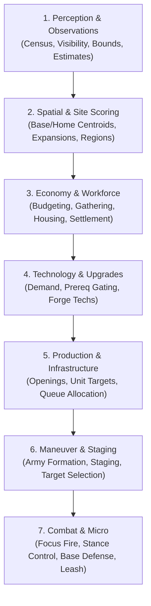

# Risq AI Architecture: Version 7 (v0.7)

The **v0.7 AI** represents a high-performing rule-based agent for the Risq strategy engine, achieving a **93.0% favorable outcome rate** (465/500), **339 blowouts**, and **zero fatal losses** across the canonical 500-game evaluation suite against `v0.6`.

This document unifies the architectural principles, subsystems, protection/funding models, combat mechanics, selector budget optimizations, and tuning learnings established throughout the v0.7 development cycle.

---

## 1. High-Level Architecture & Pipeline

The AI model is compiled from Python generators into an optimized JSON ruleset via [`gen_v07.py`](gen_v07.py). Rules are structured as a linear sequence of evaluation phases executed each game turn:



### Generator Modules Breakdown

| Subsystem | Source Files | Purpose |
| :--- | :--- | :--- |
| **Perception** | [`observations.py`](observations.py), [`estimates.py`](estimates.py), [`bounds.py`](bounds.py) | Maintains entity sets (`own_units`, `enemy_units`, `unidentified_spaces`), tracks memory decay, and estimates enemy power and composition. |
| **Spatial Analysis** | [`locations.py`](locations.py), [`sites.py`](sites.py), [`settlement.py`](settlement.py) | Identifies home base and army centroids; scores candidate foundation spaces across distance, safety, spread, and region completion. |
| **Economy & Gathering** | [`economy.py`](economy.py), [`gathering.py`](gathering.py), [`budget.py`](budget.py) | Dynamic budgeting across 4 resources; 2-pass rate-aware worker allocation avoiding resource node over-saturation. |
| **Production & Mix** | [`production.py`](production.py), [`mix.py`](mix.py), [`gold.py`](gold.py), [`hiring.py`](hiring.py) | Manages Village Centers, Barracks, and Smithies; enforces military composition ratios and mercenary contracts. |
| **Technology** | [`techs.py`](techs.py) | Evaluates tech demand and purchases upgrades with strict prerequisite gating. |
| **Maneuver & Staging** | [`army.py`](army.py), [`raiding.py`](raiding.py), [`scouting.py`](scouting.py) | Controls scouts, 1-2 unit harassment raiding parties, army staging distances, and assault readiness. |
| **Tactical Combat** | [`combat.py`](combat.py), [`defense.py`](defense.py), [`raid_response.py`](raid_response.py), [`holders.py`](holders.py) | Focus-fire target assignment (`attack_stack=2`), civilian evasion/garrisoning, local counter-raid response, and army leash. |
| **Parameters** | [`parameters.py`](parameters.py) | Exposes tunable scalar variables prefixed with `tune_*` in the compiled JSON. |

---

## 2. Protection, Funding, & Resource Budgets

Earlier rule-based iterations suffered from resource starvation, where competing queues (buildings, tech, military, workers) halted critical early-game momentum. `v0.7` resolves this via an explicit protection and funding model:

- **Protected Production**:
  - `protected_villager_share = 1.0`: Guarantees worker production through the current economic workforce goal.
  - `protected_military_producers = 1`: Shields the primary military production facility (oldest Barracks) from budget preemption.
  - `protected_military_count = 20`: Protects recruitment demand when military stands below 20 units.
- **Budgeting & Horizons**:
  - `investment_share = 0.6`: Caps long-term infrastructure/tech spending to preserve liquid stockpiles for combat and emergency defense.
  - Synchronized planning horizons (`planning_horizon = 6`, `construction_horizon = 6`, `investment_horizon = 20`) prevent excessive worker overproduction when resource reserves spike.
  - `shortage_turns = 4` and `transfer_fraction = 0.5` dynamically rebalance resource allocations across food, wood, stone, and gold during bottlenecks.
- **Worker Allocation**:
  - Rate-aware gathering uses a 1.25-turn planning window and 2 search passes.
  - Measured `VillagerIdlePctEarly` and `VCIdlePctEarly` consistently stay below 1.0% in early opening turns (turns 14–40).

---

## 3. Technology Integration & Prerequisite Gating

`v0.7` cleanly integrates secondary technologies that previously disrupted early build orders:

| Tech ID | Technology Name | Default Preference | Gating Condition & Behavior |
| :---: | :--- | :---: | :--- |
| **2** | **Bow Saw** | `0.8` | Gated on `goal_1 - own_1 < 1`. Only purchased once initial villager production is satisfied, preventing Village Center stalls. |
| **3** | **Prospecting** | `0.5` | Gated on `goal_1 - own_1 < 1`. Acquired after opening worker quotas are filled. |
| **11** | **Fertilizer** | `0.8` | Farm income booster; prioritized once farm counts justify the investment. |
| **64** | **Ballistics** | `0.5` | Siege accuracy; inert until Catapult (401) or Redoubt production is established. |
| **91** | **Bivouacs** | `0.8` | Stamina recovery bonus; bought when military operations extend beyond home borders. |
| **92** | **Escalades** | `0.5` | Wall assault modifier; purchased when enemy walls are detected. |
| **102** | **Shrapnel** | `0.5` | Area damage booster; scales Catapult damage. |

---

## 4. Combat Mechanics & Power Calibration

### Calibrated Unit Power Values
Fitted against 15,300 simulated engagements and 192 defensive fortification tests (held-out decisive engagement accuracy: 86%):

- **Villager (1)**: `0.58` base power (`0.84` after researching Farming). Civilian crush threshold: `1.4`.
- **Blunt Infantry (101)**: `1.00` base power. Primary frontline sponge and early assault body.
- **Piercing Infantry (102)**: `1.50` base power. Anti-infantry ranged/skirmish damage.
- **Heavy Infantry (103)**: `3.30` base power. Armored shock infantry.
- **Catapult (401)**: `2.40` base power (scales to `2.50` with Ballistics, `2.70` with Shrapnel, and `3.20` with both).
- **Tactical Modifiers**: Attack bonus `0.25`, Armor bonus `0.15`.

### Stance & Focus Fire
- `attack_stack = 2`: Directs friendly attackers to concentrate fire up to 2 units per enemy target.
- `civilian_defense`: Automatically evacuates or garrisons endangered villagers when enemy power threatens worker nodes, avoiding unnecessary civilian attrition.

---

## 5. Structural Fixes & Parameter Tuning (The 3-Tier Funnel)

Analysis of baseline `v0.7` identified two primary vulnerabilities:
1. **The Regional Deficit**: On regional maps (`divide`, `ring`), enemy AI claimed whole regions for a permanent +30 gold/turn income, banking thousands of unspent gold points while `v0.7` remained behind in score.
2. **The No-Economy Assault Trap**: On fixed-army maps (`army_flat`, `army_terrain`), count-only vision (`Vision: 2`) caused `v0.7` to underestimate hidden defenders and launch premature cross-border assaults. Entering an enemy tile drained 8–9 stamina; stationary defenders with 100% full stamina wiped out advancing infantry in one turn.

These issues were resolved through a rigorous 3-tier tuning funnel (24 candidates over 60 games $\rightarrow$ top 15 candidates over 180 games $\rightarrow$ top 5 candidates over the full 500-game evaluation):

### Key Parameters Finalized:
- **`site_region = 1.0`** (increased from `0`):
  - Activates regional space valuation in [`sites.py`](sites.py#L87):
    $$\text{Bonus} = \text{tune\_site\_region} \times (\text{target.region.index} \ge 0) \times (1 - \text{own\_buildings}) \times \frac{\text{owned\_spaces} + 1}{\max(1, \text{known\_spaces})}$$
  - Pushes expansion and building placement to finish contested regions.
  - **Impact on `divide`**: Behind games dropped from **7 $\rightarrow$ 3**; blowouts increased from **6 $\rightarrow$ 9**.
- **`power_odds_noeco = 1.05`** (increased from `0.85`):
  - Requires decisive power superiority before assaulting fortified, stationary positions when no economy exists.
- **`unknown_min_power = 1.7`** (increased from `1.4`):
  - Prevents underestimating unobserved enemy stacks in fog of war.
  - **Impact on `army_flat`**: Flipped the single `crushed` loss in seed `857236` into a **decisive crush win**, completely eliminating fatal losses.

---

## 6. Selector Budget Optimization

In large-army scenarios (e.g., Risk World abundant deathmatch with 2,000+ units), [`raid_response.py:leash()`](raid_response.py#L26-L34) previously exceeded the engine's 250,000 selector step budget. Two optimizations were integrated:

1. **Reordered Cheap Exclusions**:
   - In `actors`, cheap checks (`1 - inSet(raiding_party, actor)`, `1 - inSet(reserved_units, actor)`, and `assault`/`retreat` checks) now execute **before** `var(actor.refine_here) == 0`.
   - During assaults (`assault=1`), non-villagers fail immediately without computing the expensive `nearby` enemy aggregate. Peak steps on stress seeds dropped from **250,002 $\rightarrow$ 2,840**.
2. **Indexed Spatial Coordinate Join**:
   - Added explicit `owner="enemy"` and replaced `distance(actor, item) == 0` with separate coordinate equality conditions: `["var(item.x) == var(actor.x)", "var(item.y) == var(actor.y)"]`.
   - Triggers the Go engine's equality factor join planner in [`join.go`](../../../ai/join.go), indexing visible enemy units into an $O(1)$ coordinate hash map and eliminating friendly unit stack contamination.

---

## 7. Canonical Evaluation Performance (500 Games vs `v0.6`)

Official test results on [`eval.json`](../../sim/inputs/eval.json) (37 bucketed maps, 500 games, up to 100 turns):

```
verdict: v0.7 over 500 games: 277 defeat, 62 crush, 25 winning, 101 ahead, 35 behind, 0 losing, 0 crushed, 0 defeated
```

| Metric | Baseline `v0.7` | Promoted Optimized `v0.7` | Improvement |
| :--- | :---: | :---: | :---: |
| **Favorable Outcomes** | 459 / 500 (91.8%) | **465 / 500 (93.0%)** | **+6 games (+1.2%)** |
| **Blowout Wins (Defeat + Crush)** | 333 / 500 | **339 / 500** | **+6 blowouts** |
| **Crush Victories** | 49 | **62** | **+13 crushes** |
| **Fatal Losses (Crushed / Losing / Defeated)** | 1 | **0** | **100% fatal elimination** |
| **Behind Outcomes** | 40 | **35** | **-5 behind** |
| **Average Kills / Lost Ratio** | 105.8 / 40.1 | **107.4 / 40.8** | **+1.6 net kills** |
| **Selector Budget Warnings** | 0 | **0** | **Zero cap violations** |

---

## 8. Usage & Compilation

To compile the `v0.7` AI configuration:

```bash
cd backend/game/games/risq/config/ai/generators/v7
python3 gen_v07.py
```

This writes directly to [`backend/game/games/risq/config/ai/v0.7.json`](../../v0.7.json) (SHA256: `651836b2726950f246fdcd78473d40051c4e755ddb98062065d82e3eb6ac0b6f`).

To test candidate parameter overrides without modifying default values:
```bash
python3 gen_v07.py site_region=1.25 power_odds_noeco=1.1 --out=../../candidate.json
```

To run the official evaluation:
```bash
cd backend/game/games/risq/sim
./sim -quiet eval
```
