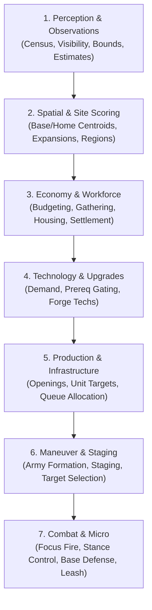

# Risq AI Architecture: Version 7 (v0.7)

The **v0.7 AI** is a rule-based agent for the Risq strategy engine, generated from the Python modules in this folder.

This document covers its architecture, subsystems, protection/funding model, combat mechanics and selector budget rules.

---

## 1. High-Level Architecture & Pipeline

The AI model is compiled from Python generators into an optimized JSON ruleset via [`gen_v07.py`](gen_v07.py). Rules are structured as a linear sequence of evaluation phases executed each game turn. The diagram groups them by subsystem; the exact order is the `phases` list in `generate()` (`gen_v07.py`):



### Generator Modules Breakdown

| Subsystem | Source Files | Purpose |
| :--- | :--- | :--- |
| **Perception** | [`observations.py`](observations.py), [`estimates.py`](estimates.py), [`bounds.py`](bounds.py) | Maintains entity sets (`own_units`, `enemy_units`, `unidentified_spaces`), tracks memory decay, and estimates enemy power and composition. |
| **Spatial Analysis** | [`locations.py`](locations.py), [`sites.py`](sites.py), [`settlement.py`](settlement.py) | Identifies home base and army centroids; scores candidate foundation spaces across distance, safety, spread, and region completion. |
| **Economy & Gathering** | [`economy.py`](economy.py), [`gathering.py`](gathering.py), [`budget.py`](budget.py) | Dynamic budgeting across all resources; multi-pass rate-aware worker allocation avoiding resource node over-saturation. |
| **Production & Mix** | [`production.py`](production.py), [`mix.py`](mix.py), [`gold.py`](gold.py), [`hiring.py`](hiring.py) | Manages Village Centers, Barracks, and Smithies; enforces military composition ratios and mercenary contracts. |
| **Technology** | [`techs.py`](techs.py) | Evaluates tech demand and purchases upgrades with strict prerequisite gating. |
| **Maneuver & Staging** | [`army.py`](army.py), [`raiding.py`](raiding.py), [`scouting.py`](scouting.py) | Controls scouts, small harassment raiding parties, army staging distances, and assault readiness. |
| **Tactical Combat** | [`combat.py`](combat.py), [`defense.py`](defense.py), [`raid_response.py`](raid_response.py), [`holders.py`](holders.py) | Focus-fire target assignment (`attack_stack`), civilian evasion/garrisoning, local counter-raid response, and army leash. |
| **Construction & Policies** | [`construction.py`](construction.py), [`foundations.py`](foundations.py), [`shelter.py`](shelter.py), [`reserves.py`](reserves.py), [`policies.py`](policies.py), [`retreat_policy.py`](retreat_policy.py) | Builders, farms, barracks, repairs and foundation recovery; reserves; post-pass policies such as the raid leash. |
| **Parameters** | [`parameters.py`](parameters.py) | Exposes tunable scalar variables prefixed with `tune_*` in the compiled JSON (`issue_*` parameters are read at generation time only). |

---

## 2. Protection, Funding, & Resource Budgets

Competing queues (buildings, tech, military, workers) are arbitrated by an explicit protection and funding model. All values are `parameters.py` entries:

- **Protected Production**:
  - `protected_villager_share`: guarantees worker production through the current economic workforce goal.
  - `protected_military_producers`: shields the primary military production facility (oldest Barracks) from budget preemption.
  - `protected_military_count`: protects recruitment demand while military is below this count.
- **Budgeting & Horizons**:
  - `investment_share`: caps long-term infrastructure/tech spending to preserve liquid stockpiles for combat and emergency defense.
  - `planning_horizon`, `construction_horizon` and `investment_horizon` keep worker production from overshooting when reserves spike.
  - `shortage_turns` and `transfer_fraction` rebalance allocations across food, wood, stone, and gold during bottlenecks.
- **Worker Allocation**:
  - Rate-aware gathering uses `gather_planning_turns` and `gather_search_passes`.

---

## 3. Technology Gating

Each tech has a `tech_<id>` preference parameter and an applicability condition in `APPLICABLE` (`techs.py`), which holds the exact thresholds:

| Tech ID | Technology Name | Gate |
| :---: | :--- | :--- |
| **2** | **Bow Saw** | Initial villager quota filled, so Village Center production is not stalled. |
| **3** | **Prospecting** | Initial villager quota filled. |
| **11** | **Fertilizer** | A completed Farm and a minimum villager count. |
| **64** | **Ballistics** | A completed Redoubt. |
| **91** | **Bivouacs** | A minimum infantry count. |
| **92** | **Escalades** | A larger infantry count and a known enemy Wall. |
| **102** | **Shrapnel** | Owning a Catapult. |

---

## 4. Combat Mechanics & Power Calibration

### Unit Power Values
Per-unit base powers, tech-state power levels, matchup weights and tactical modifiers are the `power_*`, `matchup_*` and `tactical_*` parameters in `parameters.py`.

- **Villager (1)**: civilian power, raised by Farming; the civilian crush threshold is `vil_crush_odds`.
- **Blunt Infantry (101)**: frontline sponge and early assault body.
- **Piercing Infantry (102)**: anti-infantry ranged/skirmish damage.
- **Heavy Infantry (103)**: armored shock infantry.
- **Catapult (401)**: siege; power rises with Ballistics and Shrapnel.

### Stance & Focus Fire
- `attack_stack`: directs friendly attackers to concentrate fire up to that many units per enemy target.
- `civilian_defense`: Automatically evacuates or garrisons endangered villagers when enemy power threatens worker nodes, avoiding unnecessary civilian attrition.

---

## 5. Selector Budget Rules

Large armies can exhaust the engine's per-rule selector step budget, so `raid_response.py:leash()` follows two rules:

1. **Cheap exclusions first**: in `actors`, set-membership and `assault`/`retreat` checks come before `var(actor.refine_here) == 0`, so non-villagers fail before the expensive `nearby` enemy aggregate runs.
2. **Indexed coordinate joins**: filter with `owner="enemy"` and separate equalities (`var(item.x) == var(actor.x)`, `var(item.y) == var(actor.y)`) instead of `distance(actor, item) == 0`. The equality factor join planner in [`join.go`](../../../../ai/join.go) then indexes visible enemy units by coordinate.

---

## 6. Usage & Compilation

To compile the `v0.7` AI configuration:

```bash
cd backend/game/games/risq/config/ai/generators/v7
python3 gen_v07.py
```

This writes directly to [`backend/game/games/risq/config/ai/v0.7.json`](../../v0.7.json) (regenerating is byte-identical unless the generator changed).

To test candidate parameter overrides without modifying default values:
```bash
python3 gen_v07.py site_region=1.25 power_odds_noeco=1.1 --out=../../candidate.json
```

`--list-parameters` prints each parameter's default and valid range; out-of-range values are rejected.

To run the standard evaluation (`sim/inputs/eval.json`):
```bash
cd backend/game/games/risq/sim
./sim -quiet eval
```
